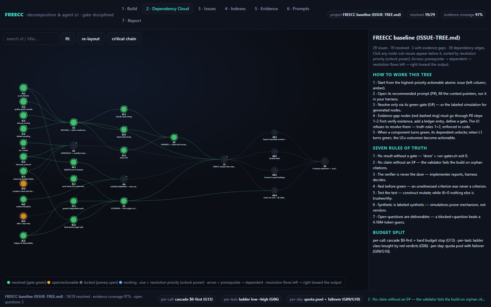

# FREECC — free Claude-Code-class agent stack

A routing + harness + verification stack that runs coding agents on **free model quotas**
(Gemini / Groq / OpenRouter / local Ollama, with near-free DeepSeek as the never-stall anchor)
and reaches Claude-Code-Max-class *effective* performance through the mechanisms that are
scientifically and empirically proven to substitute for a bigger model and a bigger wallet:

- **FrugalGPT cascade** — pay for strength only when verification proves weakness ([E6])
- **RouteLLM-style routing** — cheap-first with escalation keeps ~95%+ quality at a fraction of cost ([E7])
- **mikoshi-construct ladder** — `low→low→medium→high` reasoning budget, harness verdicts never self-reported ([E1][E2])
- **Externalized memory** — 10 discovery markers instead of a huge context window ([E3][E9])
- **Quota pooling with failover** — because free tiers shrink and 429, the pool IS the limit ([E11]–[E13])
- **Debate sampling** — optional majority-of-3 before paying the strong tier ([E10])

Everything claimed here is backed by `EVIDENCE.md` (ledger E1–E19) and executed by
`gates/run-gates.sh` (**17/17 PASS** in this workspace — see `REPORT.md`).

```
        operator (you)
        │
        ├── terminal: Claude Code ──┐        (harness/claude-code.env, E14/E15)
        ├── terminal/UI: OpenCode ──┤
        └── any OpenAI client ──────┤
                                    ▼
                    LiteLLM proxy :4000  (router/litellm.config.yaml)
                    groups: opus | sonnet | haiku   ← alias contract for mikoshi roles (E4)
                    usage-based routing + rpm/tpm + cooldown + fallback chains
                                    │
      ┌─────────────┬──────────────┼──────────────┬─────────────┐
      ▼             ▼              ▼              ▼             ▼
  Gemini free   Groq free    OpenRouter :free   DeepSeek     Ollama local
  (E11)         (E12)        (E13)              ~$0.15/M     ($0, zero quota)
                                                (E17)
        quality-gated cascade option: cascade/server.mjs :4597 (FrugalGPT-style, E6)

  project repo  ◄── mikoshi-construct init/attach (E1): AGENTS.md markers,
                    architecture policy, contracts, `pnpm run quality` harness,
                    architect/implementer/harness agents + ladder (E2)
```

## Quickstart

```bash
# 1. router (needs free keys: aistudio.google.com/apikey, console.groq.com, openrouter.ai — see router/.env.example)
cp router/.env.example router/.env && $EDITOR router/.env
router/start.sh                                   # LiteLLM on :4000  (proven to boot: gate G10)

# 2a. harness option A — Claude Code through the router (E14/E15)
harness/run-claude-code.sh                        # aliases remapped: opus/sonnet/haiku → free pools

# 2b. harness option B — OpenCode (fully free, open source, E16)
cp harness/opencode.json <your-project>/opencode.json && opencode   # model freecc/sonnet

# 3. construct — make any repo safe for weak models (E1/E2)
cd <your-project>
npx mikoshi-construct init --dry-run              # look first; then drop --dry-run (new repo: --yes --preset …)
npx mikoshi-construct doctor                      # mechanical health check (gate-proven: G04)
# in Claude Code: /construct-discover  → fills the 10 AGENTS.md markers once
# then per feature: /plan <feature> → /implement <task>   (the ladder spends budget only when the harness says so)

# 4. verify this stack itself, any time
bash gates/run-gates.sh                           # writes REPORT.md; exit 0 only if 17/17
node cascade/simulate.mjs --n 1000                # strategy simulation (synthetic replication, labeled)
```

## Layout

| Path | What it is |
|---|---|
| `ISSUE-TREE.md` | the decomposition: L0 business → L1 toolset → C1–C5 layers → sub-issues → gates, with roles, variables, spectral indexes I1–I9 |
| `PLAYBOOK.md` | the operating manual: where the definitive instructions live, seven rules of truth, value protocol, which prompt when |
| `prompts/` | the verified prompt library P0–P8 (R&D meta-prompt, setup, discovery, plan, brief, verdict, debate, escalation, tuning) + `manifest.json` + `validate.mjs` (gate G16) |
| `EVIDENCE.md` | source ledger E1–E19; no strategy exists in this repo without a ledger ID |
| `REPORT.md` | generated by `gates/run-gates.sh`: 17 mechanical gates, PASS/FAIL + evidence excerpts |
| `router/` | LiteLLM config (groups, quotas, fallbacks, budgets), `.env.example`, `start.sh` |
| `harness/` | Claude Code env+launcher, `opencode.json`, `AGENTS.md.template` (10 markers) |
| `cascade/` | zero-dep quality-gated cascade router (OpenAI-compatible, ledger, budget guard) + strategy simulation |
| `gates/` | the gate runner |
| `sandbox/` | empirical proof: real `mikoshi-construct` install + real `init` output (`sandbox/demo-lib/`, 44 files) |
| `ui/` | the interactive app: build wizard, dependency cloud, issue ranking, index register, evidence ledger, prompt library, gate report — zero-dependency, runs offline ([`ui/README.md`](ui/README.md)) |

## Interactive UI

`ui/` turns everything above into a working console: state a desired outcome, get a gated issue
tree, then explore it as a dependency cloud where **an issue with an evidence gap cannot be
marked resolved**. No dependencies, no build step, no network calls — open `ui/index.html` and it
runs, or `npm start` for a local URL.



```bash
cd ui
npm start                     # http://127.0.0.1:8080
npm test                      # 14 data invariants (ledger / gates / prompts / DAG)
npm run verify:render         # headless-Chrome render equivalence vs. the original attachment
```

`.github/workflows/pages.yml` publishes `ui/` to GitHub Pages, and `ui-ci.yml` re-runs the three
verification steps on every push.

## How "budget is divided in a smart way" (three levels, all gated)
1. **Per call** — cascade tries $0 tiers first; `budget_usd` hard-stops escalation (G13).
2. **Per task** — mikoshi ladder starts every task at the cheapest rung; the harness verdict
   (schema-validated, never self-reported) decides whether more reasoning is bought (G06).
3. **Per day** — free quotas are pooled across 4+ providers with rpm/tpm caps and cooldown
   failover, so one provider's 429 never stops the fleet (G09/G10, sim scenarios S2/S3 in G14).

Measured shape in this workspace (synthetic replication, 1000 tasks): cascade = **13.7% of
always-strong cost at ≥ accuracy**, and with the weak tier capped at 50 free requests/day
(OpenRouter's real free limit, E13) it still held **17.9% cost / ≥0.99 accuracy ratio**.

## Honest limits
- Free tiers change; model IDs/quotas in `router/.env.example` must be re-verified monthly (E11 shows Google actively cutting free quotas).
- The simulation proves mechanism, not live-model quality; your first live week should measure indexes I2/I3/I6 (ISSUE-TREE.md) and retune.
- Frontier-ceiling tasks: keep a near-free DeepSeek key (E17) or one paid key dormant in the `opus` group.
