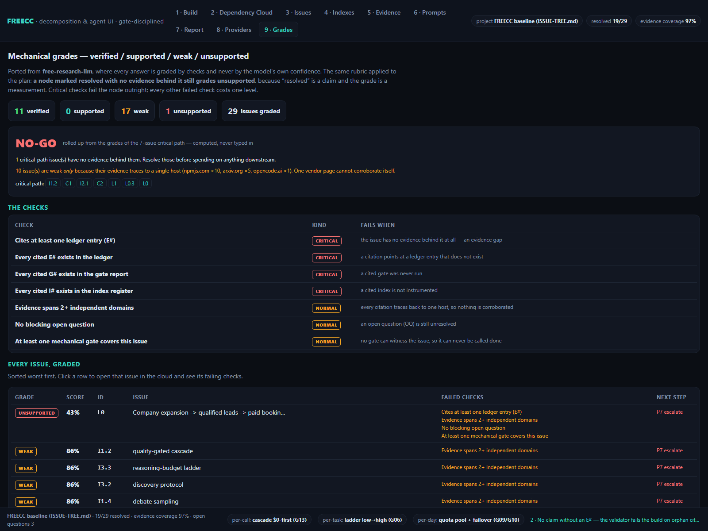
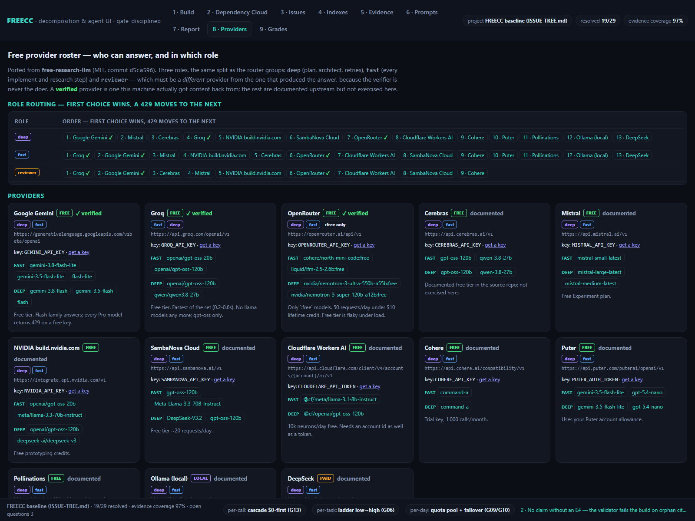

# FREECC UI

The interactive front end for [FREECC](../README.md) — a decomposition, dependency-cloud and
verification console for planning agent work under a *gate discipline*.

Zero dependencies, zero network requests, no build step. Open `index.html` and it runs.


Grades view — the mechanical rubric applied to the plan, with a computed verdict:



Providers view — the free-provider roster and role routing:



```
describe an outcome  ─▶  detect outcome-domains  ─▶  generate a gated issue tree
                                                          │
    ┌─────────────────────────────────────────────────────┴──────────────────┐
    ▼                          ▼                     ▼                      ▼
 dependency cloud        issue ranking        evidence ledger        gate report
 (prereq ▶ dependent)    (unlock power)       (E1–E19)              (G01–G18)
```

## Run it

```bash
# straight from disk — no server needed
start index.html            # Windows
open index.html             # macOS

# or over HTTP, exactly like the deployed site
npm start                   # -> http://127.0.0.1:8080
PORT=3000 npm start
```

Node is only needed for the dev server and the verification scripts, never to *use* the app.

## What is in it

| View | What it does |
|---|---|
| **1 · Build** | Prompt `P0` as a wizard: state the desired result → toggle the detected outcome-domains → generate the tree. Deterministic: the same description always yields the same seed and the same tree. |
| **2 · Dependency Cloud** | Pannable/zoomable SVG DAG. Node size = unlock power, colour = status, click for the detail panel. `critical chain` walks prerequisites to `L0`; `re-layout` reseeds the layout. |
| **3 · Issues** | Every node ranked by *importance of resolving* — own weight plus the transitive weight it unlocks. |
| **4 · Indexes** | The spectral register `I1–I9`, each with the real instrument that reads it and the `P8` tuning rule. |
| **5 · Evidence** | Ledger `E1–E19` (primary / secondary / empirical), click-through from any `E#` chip. |
| **6 · Prompts** | The verified prompt library `P0–P8` with copy-to-clipboard. Bodies live in the HTML as `<script type="text/template">`. |
| **7 · Report** | Gate report `G01–G18` plus a `replay` that re-runs the gate animation. |
| **8 · Providers** | The free-provider roster ported from `free-research-llm`: 13 providers with tier, roles, base URL, key env var, model preference lists and an honest note; role routing for `deep` / `fast` / `reviewer`; 9 search backends; and the two rules that keep a free fleet alive (never hard-code a model id; filter non-chat models out of `/models`). |
| **9 · Grades** | The mechanical rubric `verified / supported / weak / unsupported` applied to every issue, plus a computed `GO / GO-IF / NO-GO` verdict over the weighted critical path. |

## Ported capabilities

Two capabilities are ported from **[free-research-llm](https://github.com/bezgolovyponch/free-research-llm)**
(MIT, commit `d5ca596`) — an analytical-research engine that grades every answer mechanically:

1. **The grading rubric** (`src/research/verify.mjs` → `assets/grades.js`). Upstream grades a
   research answer; here the same seven checks grade an *issue*. Critical failures mean
   `unsupported`; any other failure costs one level; `verified` additionally needs two independent
   domains and a gate. A node marked `RESOLVED` with no evidence behind it still grades
   `unsupported`, because status is a claim and the grade is a measurement.

   One deliberate difference, stated so it is not mistaken for a bug: upstream applies the
   2+ domain rule only to answers claiming *high* confidence, while here it applies to every
   issue. That is why much of the shipped baseline grades `weak` — its citations cluster on
   `npmjs.com` and `arxiv.org`. The Grades tab says so explicitly, and counts the issues that are
   weak *only* for that reason.

2. **The provider roster and role routing** (`src/llm/presets.mjs` → `assets/providers.js`).
   Includes the reviewer role, which must resolve to a *different* provider than the one that
   produced the answer — the same "verifier is never the doer" rule FREECC already relies on.

The source repo's hardest-won lesson is recorded there too, because this project learned it the
same way: **model ids are read from `/models` and matched against an ordered preference list,
never hard-coded.** `router/.env.example` shipped `gemini-3-pro` (never existed) and
`qwen3-coder:free` (withdrawn); the same class of error cost this repo a debugging session.

## The truth rules are enforced in code

The UI is not a mockup: several rules from `PLAYBOOK.md` are invariants in the app itself.

- **An issue with an evidence gap cannot be resolved.** Try it — `resolve` is refused and the
  node is routed through `P0` step 2 first.
- **Resolution needs a green gate or a labelled simulation.** `runSimGate` marks simulated
  resolutions as simulated, because they prove mechanism, not vendors.
- **The verifier is never the doer.** Gates are displayed as recorded facts, not self-reported
  claims; `E18`/`E19` are the empirical entries that make them checkable.

`npm test` asserts those invariants against the data so the numbers on screen cannot silently
drift from the ledger.

## Layout

```
index.html              app shell; holds the P0-P8 prompt templates
assets/styles.css       the entire stylesheet
assets/data.js          ledger E1-E19, gates G01-G18, indexes I1-I9,
                        prompts P0-P8, 7 truth rules, the FREECC engine subtree,
                        the outcome-domain lexicon
assets/providers.js     provider roster + role routing + search backends
                        (ported from free-research-llm)
assets/grades.js        the mechanical grading rubric + verdict roll-up
                        (ported from free-research-llm)
assets/app.js           engine (detection, generation, ordering, layout),
                        SVG cloud, panels, tables, wizard, providers, grades, boot
scripts/serve.mjs       zero-dependency static server
scripts/audit.mjs       the scorecard: sizes, tests, boot, a11y, responsive, grades
scripts/verify-render.mjs  headless-browser boot + port + snapshot checks
tests/data.test.mjs     data invariants (node:test)
tests/grades.test.mjs   rubric + roster invariants (node:test)
tests/snapshots/        rendered-DOM regression snapshot
QUALITY.md              the targets this app is measured against (machine + manual)
reference/              the original single-file attachment, untouched
```

## Quality, not vibes

**[QUALITY.md](QUALITY.md)** is the scorecard: it separates what a script can prove from what a
human must look at, and `scripts/audit.mjs` produces the numbers.

```bash
node scripts/audit.mjs            # human-readable scorecard
node scripts/audit.mjs --json     # what the improvement loop consumes
node scripts/audit.mjs --strict   # the CI gate: a11y / console / overflow / payload
```

The audit drives a real headless browser with an injected probe, so it measures rather than
assumes: uncaught errors and `console.error`, external requests via Resource Timing, the app's own
JavaScript boot time via `performance.now`, horizontal overflow at a phone viewport **and which
elements cause it**, plus 14 accessibility heuristics over the rendered DOM.

| Measured | Before | Now |
|---|---|---|
| Accessibility heuristics | 3 / 14 | **14 / 14** |
| Overflow at a phone viewport | yes (1023 px vs 512) | **none** |
| DOM nodes built at boot | 2147 | **430** (lazy tabs) |
| App JS boot | — | **45 ms** |
| Console errors · external requests | 0 · 0 | **0 · 0** |

Accessibility work: one `<h1>`, a skip link, ARIA `tablist` / `tab` / `tabpanel` with
`aria-selected` and `aria-controls`, arrow-key + Home/End navigation with roving `tabindex`, a
label on every input (including JS-rendered ones), `role="status"` on the toast, `:focus-visible`
outlines, a `prefers-reduced-motion` branch that also stops the rotating ticker, and the decorative
cloud SVG marked `aria-hidden` because the Issues table is its accessible equivalent.

The improvement loop that produced these numbers — audits, LLM findings, what was accepted, and
what was rejected — is recorded in [`../loop/ROUND-LOG.md`](../loop/ROUND-LOG.md).

## Verification

```bash
npm run check          # node --check on all four scripts
npm test               # 28 invariants across two suites
npm run verify:render  # headless Chrome: boot + ported capabilities + snapshot
npm run verify         # all three
```

`scripts/verify-render.mjs` renders the page in a real browser and asserts three things:

1. **Boot** — the cloud, issue table, gates, ledger and prompts actually populated.
2. **Port present** — the provider roster, the role-routing matrix, the grade table and a computed
   verdict are on screen. A silent revert of the ported capabilities fails the build instead of
   passing it.
3. **Snapshot** — the rendered text and structural counts match
   `tests/snapshots/fingerprint.json`. A fingerprint is used rather than raw DOM because Chrome
   builds differ in SVG serialization and attribute order, which would fail CI for no real
   reason. Run `node scripts/verify-render.mjs --update` to rewrite it, but only when you
   *intend* to change the UI.

This replaced the earlier byte-equivalence test, which was only meaningful while the split from
the single-file original was behaviour-neutral. `reference/freecc-ui.original.html` is still kept
and still rendered on every run, and the script asserts the current build *differs* from it — so
the provenance claim stays checkable while the app is allowed to grow.

It exits `0` with `SKIP` when no Chromium-family browser is present; set `CHROME_PATH` to point
at one explicitly.

### Provenance

| | |
|---|---|
| original attachment | `reference/freecc-ui.original.html` |
| sha256 | `6531a05109bec066fd86efd9707d25ba0030cb5cac767b3ea38f63dbc4c1c1ac` |
| size | 80,063 bytes, 987 lines |

## Deploy

`.github/workflows/pages.yml` publishes this folder to GitHub Pages on every push that touches
`ui/`, using the Actions artifact flow (so the folder can live in a subdirectory of the repo).
`ci.yml` runs the three verification steps on every push and pull request.

## Honest limits

- The wizard's domain detection is a keyword lexicon, not an LLM call. It is deterministic on
  purpose — but it will miss domains that are not in `LEX`.
- Index values in the UI are session-local illustrations. Wire them to `.construct/runs.jsonl`,
  `cascade/ledger.jsonl` and `construct cost --json` for real numbers.
- The gate report is a recorded snapshot of a real run, not a live re-execution.
